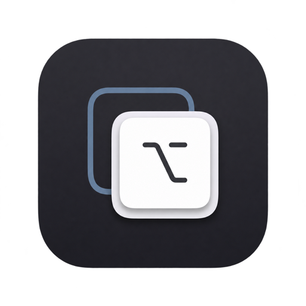

# ShortcutKey



一款轻量的 macOS 菜单栏应用，用 `⌥ Option + 键` 快速切换指定软件。目标软件未运行时启动它；已经在前台时再次按键会隐藏整个软件。

**系统要求：**Apple Silicon、macOS 26 或更新版本。

## 下载与安装

从 [最新 Release](https://github.com/yinxianwei/shortcut-key/releases/latest) 下载 macOS Apple Silicon ZIP，解压后将 `ShortcutKey.app` 移到“应用程序”文件夹。打开应用后，点击菜单栏的 `⌥` 图标进入设置。

当前公开构建使用临时签名，**未经过 Apple 公证**。如果 macOS 阻止首次打开，请确认下载来源后，前往“系统设置 → 隐私与安全性”使用“仍要打开”。未来如配置了个人 Developer ID 签名和公证，可改为直接打开的发布包。不要使用别人的开发者证书给此项目签名。

## 功能

- 程序坞和应用切换器中不显示，仅在菜单栏运行；菜单提供“设置”“重新加载配置”和“退出”。
- 设置多个 `Option + 键` 快捷键，每个快捷键对应一个软件。访达默认位于第一项，可直接设置快捷键。
- 可一次选择多个应用；已经添加的应用不会重复添加。
- 软件运行中切换到前台；已在前台时隐藏整个软件。访达没有打开的文件窗口时，按快捷键会打开用户主文件夹窗口。当前不精确控制某一个窗口，也不保证恢复目标软件已最小化的窗口。
- 设置分为“应用切换”和“窗口布局”两个标签页。窗口布局页用图标表示左半边、右半边和铺满当前屏幕的可用区域，可分别录入组合键或清除。
- 可选择登录时启动；建议先将应用移入“应用程序”文件夹。
- 配置默认保存在 `~/.config/shortcut-key/config.json`。路径输入框支持 `⌘A` 全选、`⌘C` 复制、`⌘V` 粘贴和 `⌘X` 剪切；也可选择已有配置文件，或在访达中显示当前配置文件。手动输入新路径后点击“应用路径”。

全局快捷键可能与系统或其他应用冲突。注册失败会在设置中显示错误；有些系统快捷键冲突无法提前检测。`Option + 键` 也会占用其他应用原本的组合键输入。

窗口布局需要在“系统设置 → 隐私与安全性 → 辅助功能”中允许 ShortcutKey 控制电脑。首次使用窗口快捷键时会提示授权；部分应用或特殊窗口可能不允许调整大小和位置。

## 配置示例

```json
{
  "version": 2,
  "bindings": [
    {
      "bundleID": "com.apple.finder",
      "appPath": "/System/Library/CoreServices/Finder.app"
    },
    {
      "bundleID": "com.microsoft.VSCode",
      "appPath": "/Applications/Visual Studio Code.app",
      "keyCode": 7,
      "keyName": "X"
    }
  ],
  "windowShortcuts": {
    "leftHalf": { "keyCode": 123, "keyName": "←", "modifiers": 8 },
    "rightHalf": { "keyCode": 124, "keyName": "→", "modifiers": 8 }
  }
}
```

应用切换快捷键固定包含 `Option`；窗口布局快捷键支持组合 `⌃ Control`、`⌥ Option`、`⇧ Shift`、`⌘ Command`，但至少需要一个修饰键。窗口配置中的 `modifiers` 位值依次为 `1`、`2`、`4`、`8`，可以相加。`keyCode` 是 macOS 虚拟键码。建议在设置界面录入，而不是手写键码。手动编辑配置文件后，从菜单栏选择“重新加载配置”。旧版配置仍可读取；如果删除访达，可用“添加访达”按钮恢复。

## 从源码构建

项目只依赖 Apple 系统框架和 Swift Package Manager。安装 Xcode 后执行：

```sh
swift test --arch arm64
./scripts/build-app.sh
open dist/ShortcutKey.app
```

构建产物在 `dist/ShortcutKey.app`。脚本使用本机临时签名，仅适合本机测试。提交到 `main` 或发起 Pull Request 时，[CI](.github/workflows/ci.yml) 会运行测试和构建；推送版本标签 `vX.Y.Z` 时，[Release Action](.github/workflows/release.yml) 会在 macOS 26 Apple Silicon runner 上构建、打包并发布带 SHA-256 校验文件的 ZIP。

## 许可证

[MIT](LICENSE)。
